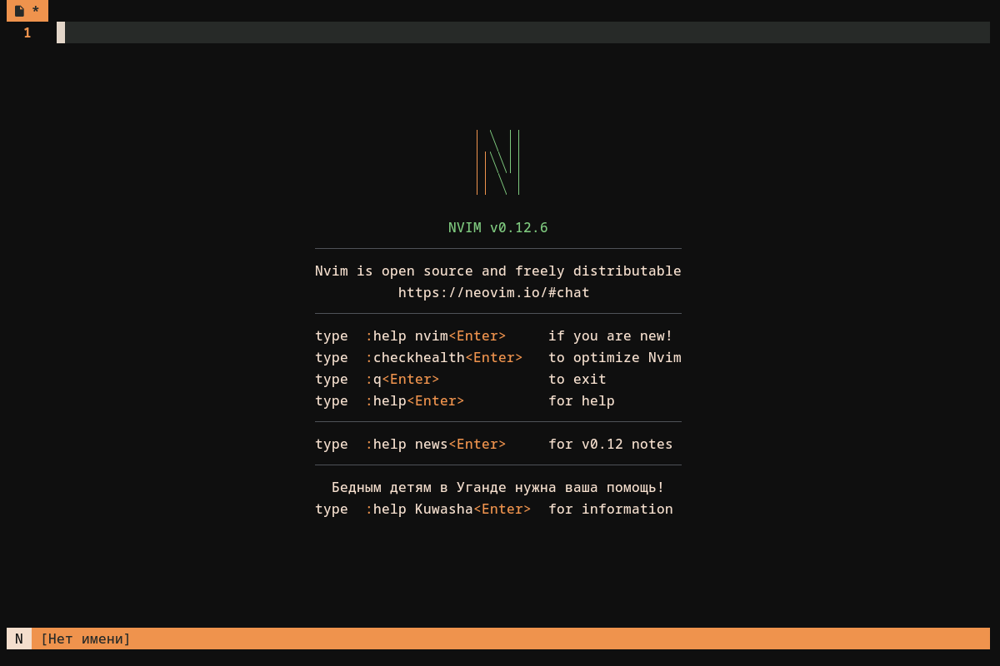
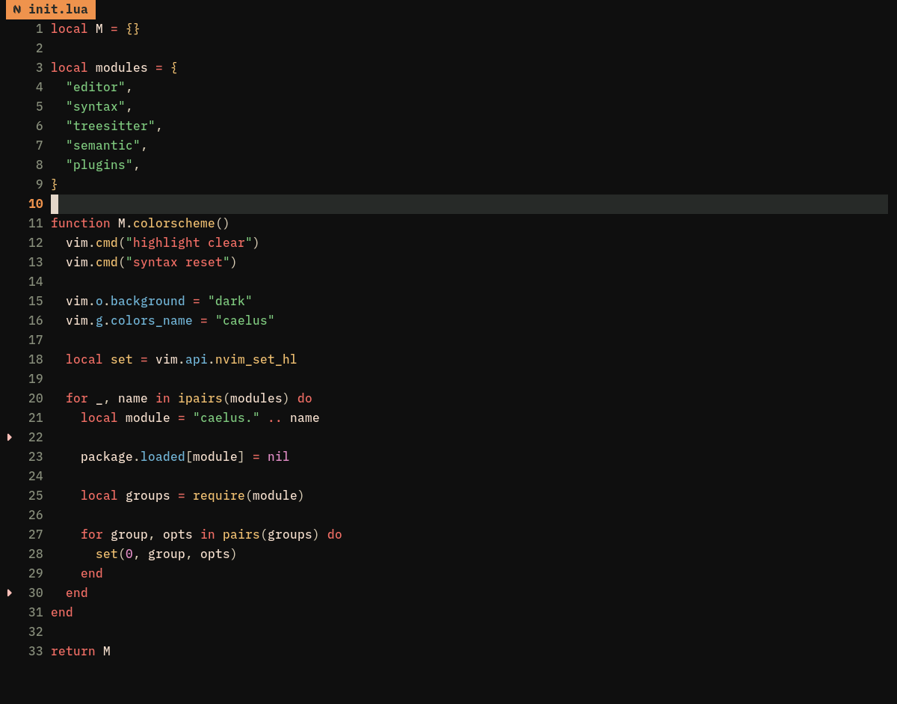
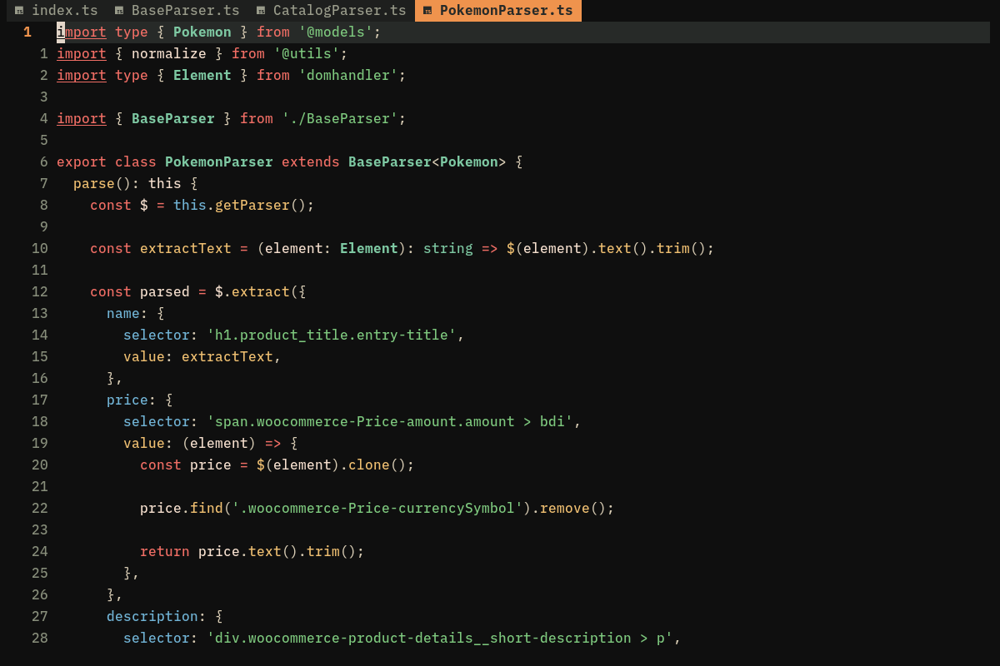

# Caelus.nvim

A dark Neovim colorscheme based on the original [Caelus](https://git.symlinx.net/daccfiles/tree/.config/nvim-raw/lua/caelus) by **dacctal**.

An independently maintained version with extended Tree-sitter highlighting, LSP semantic tokens, and plugin integrations.

## Preview



### Lua



### TypeScript



## Installation

### vim.pack (Neovim 0.12+)

```lua
vim.pack.add({
  { src = "https://github.com/Dmich98/caelus.nvim" },
})

vim.cmd.colorscheme("caelus")
```

### lazy.nvim

```lua
{
  "Dmich98/caelus.nvim",
  lazy = false,
  priority = 1000,
  config = function()
    vim.cmd.colorscheme("caelus")
  end,
}
```

## Integrations

Includes highlight groups for:

- Tree-sitter and LSP semantic tokens
- blink.cmp
- flash.nvim
- mini.nvim (statusline, tabline, starter, notify)

No additional configuration is required for these integrations.

## Credits

- **Original author:** [dacctal](https://git.symlinx.net/daccfiles)
- **Original source:** [Caelus](https://git.symlinx.net/daccfiles/tree/.config/nvim-raw/lua/caelus)

## License

Licensed under the [GNU General Public License v3.0](LICENSE), following the original repository's license.
